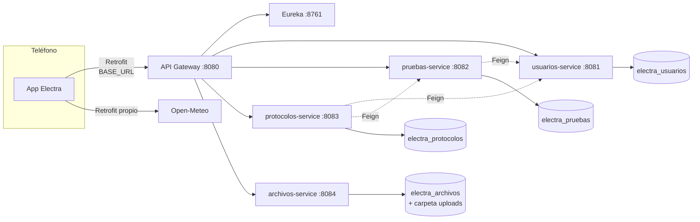
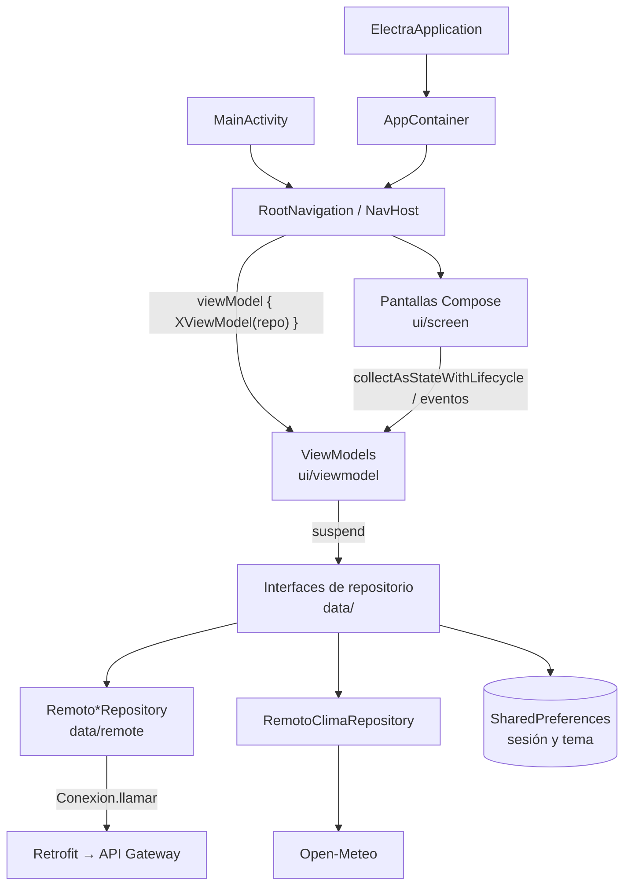
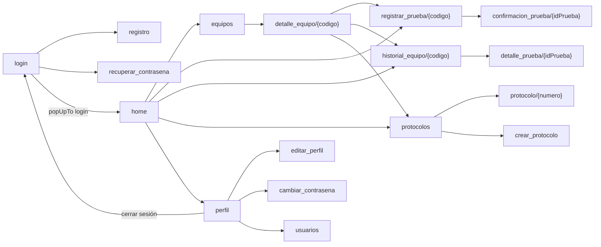
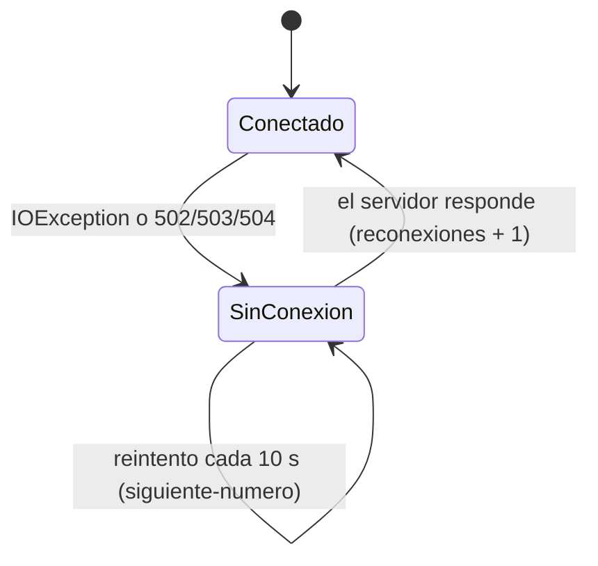

# Arquitectura de Electra

> **Actualización 21/11/2026 (Evaluación Final).** La app deja de guardar los datos en el teléfono
> (SQLite y `SharedPreferences` de usuarios) y pasa a consumir **microservicios** con Retrofit a
> través de un API Gateway. Se agregan la API externa Open-Meteo, el Splash Screen, el reintento
> automático de conexión y 78 pruebas unitarias con 91 % de cobertura.
> El backend está en el repositorio [Electra-Backend](https://github.com/Simon2853/Electra-Backend).

**Autor:** Simón Muñoz · simon.munoz952@gmail.com

Electra es una app Android nativa (Kotlin + Jetpack Compose) para que técnicos de terreno
registren **pruebas eléctricas** sobre equipos (transformadores, relés, celdas, cables) y
gestionen **protocolos** de inspección que luego un supervisor formaliza.

## 1. Stack y configuración

| Aspecto | Valor |
|---|---|
| Módulos Gradle | uno solo: `:app` |
| Lenguaje / UI | Kotlin (integrado en AGP 9.4.1), Jetpack Compose (BOM 2026.02.01), Material 3 |
| SDK | `minSdk 24`, `targetSdk/compileSdk 37`, Java 11 |
| Navegación | `navigation-compose` 2.9.5 (rutas tipo *string*) |
| Red | **Retrofit 3** + Gson, OkHttp compartido; **Coil 3** para las fotos del servidor |
| Datos | Microservicios del backend (MySQL). En el teléfono solo la sesión y el tema (`SharedPreferences`) |
| API externa | Open-Meteo (clima actual por coordenadas, sin clave) |
| Inicio | `core-splashscreen` 1.2.0 (`Theme.Electra.Splash`) |
| Pruebas | JUnit 4, `kotlinx-coroutines-test`, JaCoCo 0.8.14 |
| Actividades | una: `MainActivity` (single-activity) |

## 2. Vista general: app + backend



- La app **solo conoce al Gateway**. El Gateway pregunta a Eureka dónde está cada servicio y le
  reenvía la petición según la ruta (`/api/usuarios/**`, `/api/pruebas/**`, …).
- La dirección del Gateway está en un único lugar: `ConfiguracionApi.BASE_URL`
  (`http://10.0.2.2:8080/` en el emulador, o la URL pública del reenvío de puertos de VS Code en un teléfono físico).
- Las reglas de negocio importantes se validan **en el servidor** (quién ve qué, quién formaliza, que un
  protocolo formalizado no se modifique). La app repite las validaciones de formularios para avisar antes de enviar.

## 3. Estructura de paquetes

```
com.example.electra
├── ElectraApplication.kt      Application: crea y expone el AppContainer
├── MainActivity.kt            Splash, permiso de red local, tema, aviso sin conexión y RootNavigation
├── navigation/
│   ├── Routes.kt              Constantes de rutas y helpers para armar rutas con argumentos
│   └── RootNavigation.kt      NavHost: grafo completo, crea los ViewModels por destino
├── model/                     Prueba, Protocolo, Rol, Clima, Avatar, ModoTema, CatalogoEquipos, Respaldo
├── validation/Validaciones.kt Reglas de validación puras (sin Android)
├── data/
│   ├── AppContainer.kt        Inyección manual: crea Retrofit, Conexion y los repositorios
│   ├── *Repository.kt         Interfaces que usan los ViewModels (usuarios, pruebas, protocolos, clima, ajustes)
│   ├── SesionPreferencias.kt  Usuario con sesión abierta (SharedPreferences)
│   ├── AjustesRepository.kt   Tema claro / oscuro / sistema (SharedPreferences)
│   ├── Alcance.kt             Regla de qué registros ve cada rol (la usan los repositorios en memoria)
│   ├── RepositoriosEnMemoria.kt Implementaciones en memoria para pruebas unitarias y vistas previas
│   └── remote/
│       ├── ConfiguracionApi.kt BASE_URL, cliente OkHttp compartido y Retrofit
│       ├── Apis.kt            Interfaces Retrofit: UsuariosApi, PruebasApi, ProtocolosApi, ArchivosApi
│       ├── Dtos.kt            JSON que envían y reciben los microservicios
│       ├── Conexion.kt        Captura fallos de red, estado "sin conexión" y reintento automático
│       ├── ArchivosRemoto.kt  Sube fotos locales a archivos-service antes de guardar el registro
│       ├── Remoto*Repository.kt Implementaciones que llaman a los microservicios
│       └── OpenMeteo.kt       API externa del clima
├── device/                    Cámara (archivos de evidencia), GPS, vibración, compartir
└── ui/
    ├── theme/                 ElectraTheme (Material 3), paleta corporativa, tipografía
    ├── components/            Campos validados, botones, barra superior, AvisoSinConexion, avatares
    ├── viewmodel/             Un ViewModel por pantalla con datos (StateFlow)
    └── screen/                Pantallas Compose
```

## 4. Vista por capas



La app sigue **MVVM con repositorios**:

- **Pantallas**: renderizan el `uiState` del ViewModel y le envían eventos. Solo guardan estado
  efímero de UI (menús abiertos, diálogos).
- **ViewModels**: exponen `StateFlow<XUiState>`, validan, llaman al repositorio dentro de
  `viewModelScope` y publican resultados de una sola vez (`resultado`, `mensaje`) que la pantalla
  muestra como Toast o navegación y luego marca como consumidos.
- **Repositorios**: interfaces con funciones `suspend`. Al pasar de SQLite a los microservicios
  **solo se cambiaron las implementaciones** en `AppContainer`; ViewModels y pantallas quedaron igual.
- **Pruebas unitarias**: crean los repositorios remotos con APIs falsas (`Apoyo.kt`) o usan los
  repositorios en memoria, así se prueba toda la lógica sin servidor ni emulador.

### 4.1 Pantallas y ViewModels

| Pantalla | ViewModel | Repositorios | Microservicio |
|---|---|---|---|
| `Login` | `LoginViewModel` | usuarios, sesión | usuarios (`/api/auth/login`) |
| `Registro` | `RegistroViewModel` | usuarios | usuarios (`/api/auth/registro`) |
| `RecuperarContrasena` | `RecuperarContrasenaViewModel` | usuarios | usuarios (`/api/auth/restablecer`) |
| `Home` | `HomeViewModel` | pruebas, protocolos, usuarios, sesión | pruebas, protocolos, usuarios |
| `Equipos`, `DetalleEquipo` | — | catálogo fijo (`CatalogoEquipos`) | — |
| `RegistrarPrueba` | `RegistrarPruebaViewModel` | pruebas, ubicación, clima | archivos (foto) + pruebas; Open-Meteo |
| `HistorialEquipo` | `HistorialEquipoViewModel` | pruebas | pruebas |
| `DetallePrueba`, `ConfirmacionPrueba` | `DetallePruebaViewModel` | pruebas | pruebas |
| `Protocolos` | `ProtocolosViewModel` | protocolos | protocolos |
| `CrearProtocolo` | `CrearProtocoloViewModel` | protocolos, pruebas | protocolos (`siguiente-numero`, crear) |
| `DetalleProtocolo` | `DetalleProtocoloViewModel` | protocolos, pruebas | protocolos (formalizar, observaciones) |
| `Perfil` | `PerfilViewModel` | usuarios, sesión, pruebas, protocolos | usuarios, pruebas, protocolos |
| `EditarPerfil` | `EditarPerfilViewModel` | usuarios, sesión | usuarios + archivos (foto de perfil) |
| `CambiarContrasena` | `CambiarContrasenaViewModel` | usuarios, sesión | usuarios |
| `Usuarios` (solo admin) | `UsuariosViewModel` | usuarios, sesión | usuarios (cambiar rol) |

Las pantallas con listas llaman a `viewModel.cargar()` en `ON_RESUME` y también con `AlReconectar { }`
cuando vuelve la conexión con el servidor.

### 4.2 Navegación

`startDestination` es `home` si hay sesión guardada y `login` si no. Las rutas con argumentos se arman
con los helpers de `Routes` (`detallePrueba(id)`, `protocolo(numero)`, …). El número de protocolo se pasa
**sin `#`** en la ruta (el `#` rompería la URI) y el servidor lo acepta con o sin él.



## 5. Capa de red (`data/remote`)

### 5.1 Retrofit

- `ConfiguracionApi.retrofit` usa `BASE_URL`, `GsonConverterFactory` y un `OkHttpClient` compartido con
  Coil (tiempos de espera de 10/20/30 s y el encabezado que omite la página de aviso de los túneles de VS Code).
- Cada endpoint es una función `suspend` en `Apis.kt` que devuelve `Response<T>`, para revisar el código
  HTTP: `201` creado, `401` contraseña incorrecta, `404` no existe, `409` conflicto (usuario repetido o
  protocolo formalizado), `503` servicio caído.
- Los DTOs (`Dtos.kt`) se convierten a los modelos de la app (`Prueba`, `Protocolo`, `UsuarioResumen`)
  dentro de los repositorios remotos.

### 5.2 Errores de red y reconexión (`Conexion`)



- Toda llamada pasa por `conexion.llamar { … }`: si falla la red devuelve `null` en vez de lanzar una
  excepción, así la app nunca se cierra por un error de red.
- `sinConexion` muestra la franja roja `AvisoSinConexion` en todas las pantallas.
- `vigilar` reintenta cada 10 s mientras no haya conexión. Al volver, `reconexiones` aumenta y
  `AlReconectar` recarga la pantalla abierta.
- Android 17 exige el permiso `ACCESS_LOCAL_NETWORK` para llegar a `10.0.2.2`; `MainActivity` lo pide
  solo si `BASE_URL` es una dirección local. `network_security_config.xml` permite HTTP sin cifrar solo
  para `10.0.2.2` y `localhost` (la URL pública es HTTPS).

### 5.3 Fotos (`ArchivosRemoto`)

1. La cámara guarda la foto en el teléfono (`FileProvider`).
2. Al guardar la prueba o el perfil, `ArchivosRemoto.preparar` la sube a `archivos-service` (multipart).
3. El servidor devuelve una **ruta relativa** (`/api/archivos/{id}`); se guarda esa ruta en el registro.
4. Si la subida falla, **no** se registra la prueba y la foto local se conserva para reintentar.
5. Para mostrarla, `ConfiguracionApi.urlCompleta` le antepone la `BASE_URL` actual y Coil la descarga.
   Por eso las fotos siguen funcionando aunque cambie la URL pública del túnel.

### 5.4 API externa: Open-Meteo

- `RemotoClimaRepository` tiene su propio Retrofit hacia `https://api.open-meteo.com/` y **no pasa** por
  el Gateway ni por `Conexion`: si el clima falla no aparece el aviso de servidor caído y se puede
  registrar la prueba igual.
- Al capturar el GPS en _Registrar prueba_ se consulta temperatura, humedad y código WMO.
- Regla de negocio (`Clima.condicionesAdversas`): humedad ≥ 80 % o precipitación → se advierte que el
  ambiente puede alterar la medición (p. ej. la resistencia de aislamiento) y se ofrece agregarlo a las observaciones.

## 6. Roles y alcance de los datos

| Permiso | Técnico | Supervisor | Admin |
|---|:-:|:-:|:-:|
| Registrar prueba / crear protocolo | ✔ | ✘ | ✔ |
| Editar observaciones (si no está formalizado) | ✔ | ✔ | ✔ |
| Formalizar protocolo | ✘ | ✔ | ✔ |
| Gestionar usuarios y roles | ✘ | ✘ | ✔ |
| Ver registros de otros | ✘ | ✔ | ✔ |

`model/Rol.kt` es la única fuente de permisos en la app (oculta botones y valida en los ViewModels).
El servidor aplica la misma regla: las consultas envían `?usuario=<login>` y pruebas-service /
protocolos-service filtran según el rol que obtienen de usuarios-service por Feign.

## 7. Flujo típico: registrar una prueba

1. `Home`/`DetalleEquipo` → `registrar_prueba/{codigo}`.
2. El técnico completa el formulario, toma la foto y captura el GPS; la tarjeta del clima se llena con Open-Meteo.
3. `RegistrarPruebaViewModel.guardar()` valida todo con `Validaciones` (medición numérica, fecha no
   futura, motivo obligatorio si es rechazada).
4. `RemotoPruebasRepository.insertar` sube la foto a archivos-service y luego hace `POST /api/pruebas`
   con la ruta de la foto y el usuario de la sesión.
5. Con `201` la app vibra, abre la confirmación y borra la copia local de la foto. Sin conexión
   muestra el error y el formulario queda como estaba.
6. `HistorialEquipo` recarga en `ON_RESUME` y muestra la nueva prueba comparada con la anterior.

## 8. Pruebas unitarias

| Archivo | Pruebas |
|---|---:|
| `AutenticacionTest.kt` | 17 |
| `PerfilTest.kt` | 17 |
| `PruebasElectricasTest.kt` | 22 |
| `ProtocolosTest.kt` | 22 |
| **Total** | **78** |

- `Apoyo.kt` define `MainDispatcherRule` (reemplaza `Dispatchers.Main` en la JVM) y APIs falsas
  (`UsuariosApiFalsa`, `PruebasApiFalsa`, `ProtocolosApiFalsa`, `ArchivosApiFalsa`, `OpenMeteoFalsa`)
  que responden con los mismos códigos HTTP que los microservicios o simulan la falta de red.
- Nombres con el formato `accion_condicion_resultado`, por ejemplo
  `formalizar_comoTecnico_noTienePermiso`.
- Cobertura con JaCoCo (`.\gradlew verificarCoberturaPruebas`): **91 % de líneas** de `model`,
  `validation`, `ui/viewmodel` y `data`. Se excluyen las partes que necesitan Android en ejecución
  (pantallas, navegación, tema, dispositivo, `AppContainer`, `SharedPreferences`).

## 9. Decisiones y pendientes

- **Inyección manual** (`AppContainer`) en vez de Hilt: pocas dependencias y se entiende fácil.
- **Sin caché offline**: si el servidor no responde, la app avisa y reintenta, pero no guarda cambios
  para enviarlos después. Una mejora futura sería Room como caché con sincronización.
- **Catálogo de equipos fijo** en `CatalogoEquipos`; podría pasar a su propio microservicio.
- **La URL pública cambia** con cada túnel de VS Code: hay que actualizar `BASE_URL` y recompilar.
  Una mejora sería poder configurarla desde la app.

---

**Simón Muñoz**\
simon.munoz952@gmail.com\
21/11/2026
