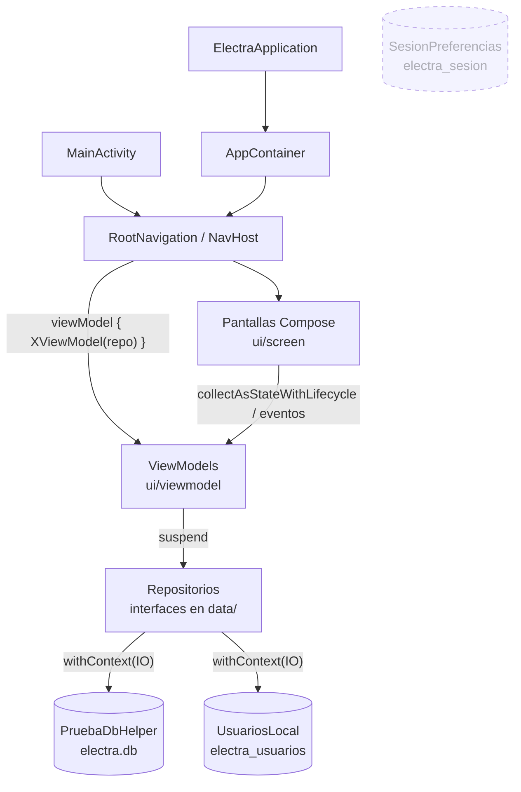
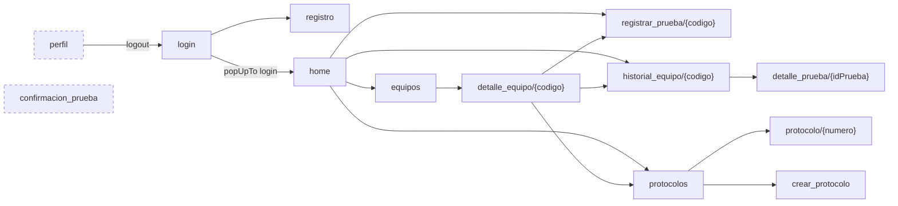

# Arquitectura de Electra

> Revisión realizada el 23/10/2026 sobre el código de `app/src/main`.
> **Autor:** Simón Muñoz · simon.munoz952@gmail.com

Electra es una app Android nativa (Kotlin + Jetpack Compose) para que técnicos de terreno
registren **pruebas eléctricas** sobre equipos (transformadores, relés, celdas, cables) y
gestionen **protocolos** de inspección. Funciona 100 % offline: no hay backend ni red.

## 1. Stack y configuración

| Aspecto | Valor |
|---|---|
| Módulos Gradle | uno solo: `:app` |
| Lenguaje / UI | Kotlin 2.2.10, Jetpack Compose (BOM 2026.02.01), Material 3 |
| SDK | `minSdk 24`, `targetSdk/compileSdk 37`, Java 11 |
| Navegación | `navigation-compose` 2.9.5 (rutas tipo *string*) |
| Persistencia | `SQLiteOpenHelper` (SQLite directo) + `SharedPreferences` |
| Actividades | una: `MainActivity` (single-activity) |

## 2. Estructura de paquetes

```
com.example.electra
├── ElectraApplication.kt      Application: crea y expone el AppContainer
├── MainActivity.kt            Punto de entrada: tema + RootNavigation(contenedor)
├── navigation/
│   ├── Routes.kt              Constantes de rutas y helpers para armar rutas con argumentos
│   └── RootNavigation.kt      NavHost: grafo completo, crea los ViewModels por destino
├── model/
│   ├── Prueba.kt              Data class de una prueba eléctrica
│   ├── Protocolo.kt           Data class de un protocolo
│   └── CatalogoEquipos.kt     Códigos de equipo por defecto (antes duplicados en 4 lugares)
├── data/
│   ├── AppContainer.kt        Inyección manual: una única PruebaDbHelper + repositorios
│   ├── PruebasRepository.kt   Interfaz + SqlitePruebasRepository (I/O en Dispatchers.IO)
│   ├── ProtocolosRepository.kt Interfaz + SqliteProtocolosRepository
│   ├── UsuariosRepository.kt  Interfaz + LocalUsuariosRepository
│   ├── RepositoriosEnMemoria.kt Implementaciones en memoria para previews y tests
│   ├── PruebaDBHelper.kt      SQLite "electra.db" (tablas pruebas y protocolos)
│   ├── UsuariosLocal.kt       Usuarios en SharedPreferences (hash SHA-256)
│   └── SesionPreferencias.kt  Id de técnico en sesión (SharedPreferences) — sin uso
└── ui/
    ├── theme/                 ElectraTheme (Material 3, colores dinámicos), tipografía
    ├── viewmodel/             Un ViewModel por pantalla con datos (StateFlow)
    └── screen/                Pantallas Compose (+ Prueba.kt legado)
```

## 3. Vista por capas



La app sigue **MVVM con repositorios**:

- **Pantallas**: renderizan el `uiState` del ViewModel y le envían eventos. Solo guardan estado
  efímero de UI (menús abiertos, diálogos, campos de Login/Registro/RegistrarPrueba).
- **ViewModels**: exponen `StateFlow<XUiState>`, validan, llaman al repositorio dentro de
  `viewModelScope` y publican resultados de una sola vez (`resultado`, `mensaje`,
  `ingresoExitoso`) que la pantalla muestra como Toast o navegación y luego marca como consumidos.
- **Repositorios**: interfaces con funciones `suspend`. Las implementaciones reales hacen el I/O
  en `Dispatchers.IO`; las de memoria permiten previews y tests sin disco.
- **AppContainer**: crea una sola `PruebaDbHelper` compartida. `RootNavigation` lo recibe por
  parámetro, así los tests inyectan uno aislado.

Los ViewModels se crean con `viewModel { … }` dentro de cada `composable(...)`, así quedan
asociados a la entrada del back stack y sobreviven a la rotación.

### 3.1 Capa de presentación (`ui/screen` + `ui/viewmodel`)

Cada pantalla recibe su ViewModel y lambdas de navegación (`onBackClick`, `onNavigate(route)`,
etc.), lo que la desacopla del `NavController`. Las listas que deben reflejar cambios al volver
atrás llaman a `viewModel.cargar()` en `LifecycleEventEffect(ON_RESUME)`.

| Pantalla | ViewModel | Repositorio | Operaciones |
|---|---|---|---|
| `Login` | `LoginViewModel` | `UsuariosRepository` | validar usuario/contraseña |
| `Registro` | `RegistroViewModel` | `UsuariosRepository` | validar formulario (`validarRegistro`) y crear usuario |
| `Home` | — | estático | accesos rápidos, actividad reciente fija |
| `Equipos` | — | lista fija en código (5 equipos) | búsqueda y filtro por tipo |
| `DetalleEquipo` | — | parámetro `codigo` + datos fijos | navegar a prueba / historial / protocolos |
| `RegistrarPrueba` | `RegistrarPruebaViewModel` | `PruebasRepository` | validar medición, insertar |
| `HistorialEquipo` | `HistorialEquipoViewModel` | `PruebasRepository` | equipos con registros, pruebas por equipo |
| `DetallePrueba` | `DetallePruebaViewModel` | `PruebasRepository` | buscar por id |
| `Protocolos` | `ProtocolosViewModel` | `ProtocolosRepository` | listar (los filtros quedan en la UI) |
| `CrearProtocolo` | `CrearProtocoloViewModel` | `ProtocolosRepository`, `PruebasRepository` | estado del formulario, número sugerido, insertar |
| `DetalleProtocolo` | `DetalleProtocoloViewModel` | `ProtocolosRepository` | buscar, formalizar, editar observaciones |
| `Perfil` | — | estático | logout (navega a Login), sync sin implementar |
| `ConfirmacionPrueba` | — | estático | — |

### 3.2 Navegación (`navigation`)

Grafo único con `startDestination = login`. Las rutas con argumentos se arman con
`String.replace("{codigo}", …)` o con los helpers `Routes.detallePrueba()` / `Routes.protocolo()`.



El número de protocolo se pasa **sin `#`** en la ruta (el `#` rompería la URI) y
`PruebaDbHelper` lo busca tanto con como sin `#`.

### 3.3 Capa de datos (`data`)

**`PruebaDbHelper`** (`electra.db`, versión 2):

| Tabla | Columnas | Notas |
|---|---|---|
| `pruebas` | `id` PK autoinc, `equipo`, `tipo_prueba`, `fecha`, `hora`, `medicion`, `unidad`, `resultado`, `observaciones` | todo `TEXT NOT NULL` |
| `protocolos` | `id` PK autoinc, `numero` UNIQUE, `equipo`, `fecha`, `estado`, `responsable`, `observaciones` | estado: "Registrado en terreno" / "Formalizado"; 4 filas semilla |

- Fechas y horas se guardan como texto (`dd/MM/yyyy`, `HH:mm`); las mediciones también son texto.
- No hay relación por clave foránea entre equipos, pruebas y protocolos: se vinculan por el código del equipo como string.
- `onUpgrade` solo contempla la migración 1 → 2 (crea `protocolos`).
- Los errores de inserción se capturan y se devuelven como `-1L`.

**`UsuariosLocal`**: usuarios en `SharedPreferences` `electra_usuarios`
con claves `nombre_<usuario>` y `hash_<usuario>` (SHA-256 sin sal).

**`SesionPreferencias`**: guarda el id del técnico en sesión, pero **no se usa** en ningún lugar.

### 3.4 Flujo típico: registrar una prueba

1. `Home`/`DetalleEquipo` → `registrar_prueba/{codigo}`.
2. `RegistrarPrueba` arma un `model.Prueba` con el formulario y llama a `RegistrarPruebaViewModel.guardar()`.
3. El ViewModel valida la medición e inserta con `PruebasRepository` (en `Dispatchers.IO`), y publica
   `resultado = EXITO | ERROR | MEDICION_VACIA`.
4. La pantalla muestra el Toast y, si fue `EXITO`, hace `popBackStack()`.
5. `HistorialEquipo` llama a `cargar()` en `ON_RESUME` y muestra la nueva fila; al tocarla abre `detalle_prueba/{id}`.

## 4. Hallazgos de la revisión

### Riesgos / defectos

1. ~~**I/O en el hilo principal.**~~ **Resuelto (23/10/2026):** todo el acceso a SQLite y a
   SharedPreferences pasa por repositorios que usan `Dispatchers.IO`, llamados desde ViewModels.
2. **La sesión no persiste.** `Login` no llama a `SesionPreferencias.guardar()` y el grafo
   siempre arranca en `login`; el usuario debe autenticarse en cada arranque.
3. **Pantallas inalcanzables.** Ninguna pantalla navega a `perfil` (y por tanto al logout)
   ni a `confirmacion_prueba`. `ui/screen/Protocolo.kt` no está registrado en el grafo.
4. **Catálogo de equipos inconsistente.** Las cuatro listas duplicadas ahora usan
   `CatalogoEquipos.CODIGOS_POR_DEFECTO`, pero `Equipos.kt` sigue con su propia lista (incluye
   `CB-012`) y los protocolos semilla usan códigos `TRA-001`, `REL-025` que no existen en
   ninguna. No hay tabla `equipos`.
5. **Clase `Prueba` duplicada.** `ui/screen/Prueba.kt` define otra `Prueba` (sin `id`) y un
   `RegistroPruebas` en memoria que ya no se usan; se confunde fácilmente con `model.Prueba`.
6. **Seguridad de credenciales.** SHA-256 sin sal ni estiramiento y `allowBackup="true"`:
   los hashes viajan en los respaldos. Para algo local conviene PBKDF2 + sal y excluir
   `electra_usuarios` en `backup_rules.xml` / `data_extraction_rules.xml`.
7. **Numeración de protocolos frágil.** `CrearProtocolo` calcula el número como
   `count + 126`; si se borra o ya existe un número, choca con el `UNIQUE` y falla el guardado.
8. **Valores por defecto silenciosos.** Si falta un argumento de ruta se usa `"TR-001"`,
   `"000125"` o `1L`, mostrando datos de otro registro en vez de un error.
9. **`Home` con accesos fijos a `TR-001`**, incluido el ícono de notificaciones, y
   actividad reciente estática.

### Deuda en dependencias

`app/build.gradle.kts` declara bibliotecas que no se usan: **Room** (además sin plugin
KSP, no funcionaría), **Retrofit/Gson**, **DataStore**, **Coil**, **window-size-class** y
**MockK**. Las versiones literales deberían pasar a `libs.versions.toml`. (Ya se quitó el
`lifecycle-runtime-ktx` duplicado: lifecycle se toma del catálogo, 2.11.0, con
`lifecycle-viewmodel-compose` y `lifecycle-runtime-compose`.)

### Otros

- `ElectraTheme` conserva la paleta púrpura de la plantilla y usa color dinámico, mientras
  las pantallas pintan colores fijos (`0xFF173B57`, `0xFF1769AA`…) repetidos en cada archivo.
- Las pantallas son largas (300–650 líneas) mezclando lógica y UI; hay componentes casi
  iguales repetidos (barras superiores, filas de información).
- Tests: ver la cobertura en [PROCESO.md](PROCESO.md) §7.

## 5. Evolución recomendada

Orden sugerido, de mayor a menor impacto:

1. ~~**ViewModel + Repositorio por feature**~~ **Hecho (23/10/2026).** Ver §3.
2. **Migrar a Room** (ya está en dependencias): entidades `Equipo`, `Prueba`, `Protocolo`
   con claves foráneas, DAOs con `Flow` (elimina la recarga manual en `ON_RESUME`) y
   migraciones explícitas.
3. **Sesión real**: persistir el usuario (DataStore) al iniciar sesión, elegir la
   `startDestination` según haya sesión y exponer el acceso a `Perfil` desde `Home`.
4. **Fuente única de equipos** en BD, reemplazando las listas fijas.
5. **Limpieza**: borrar `ui/screen/Prueba.kt` y `Protocolo.kt` (o enlazarlo), quitar
   dependencias sin uso y centralizar colores en el tema.
6. Navegación con rutas tipadas (`@Serializable`) de navigation-compose 2.8+ para evitar
   el `replace("{codigo}", …)` manual.

---

**Simón Muñoz**\
simon.munoz952@gmail.com\
23/10/2026
