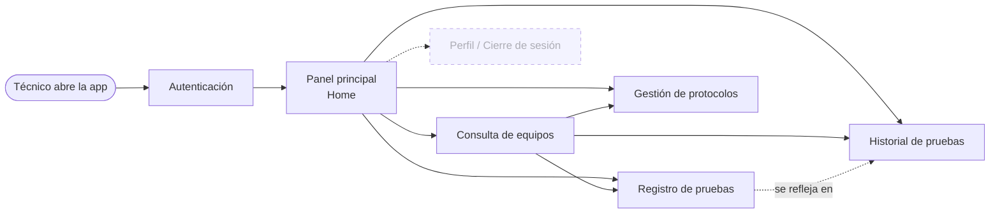
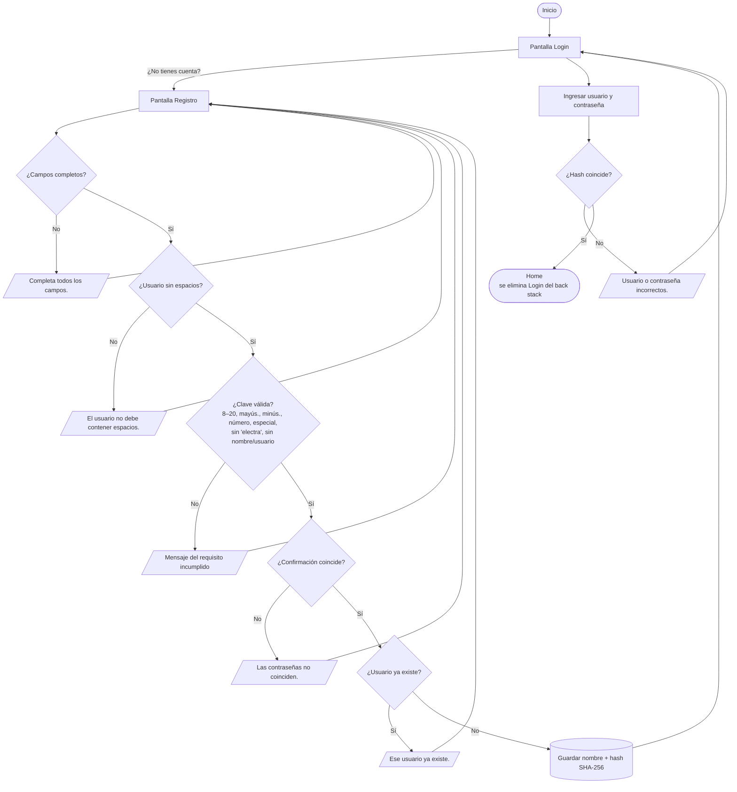
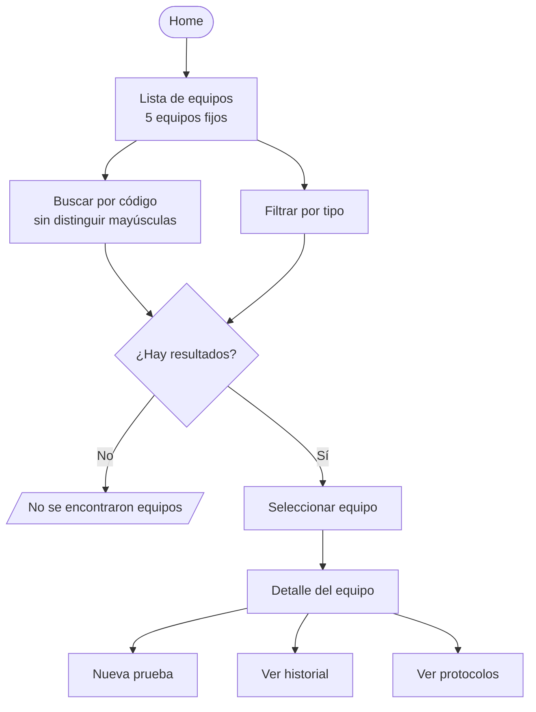
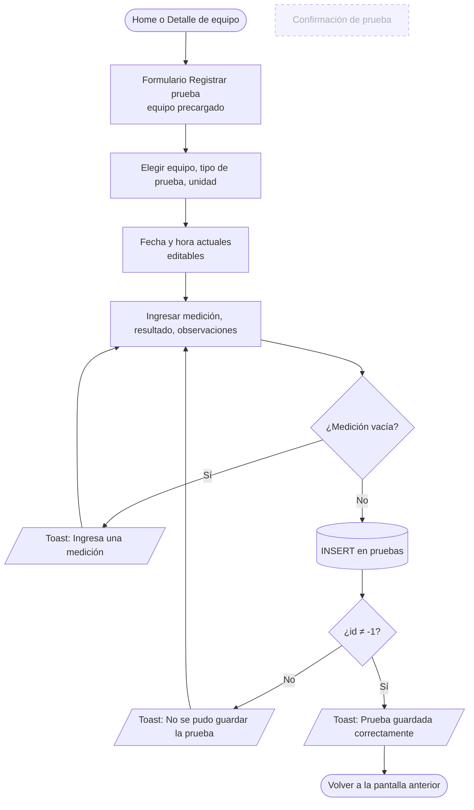
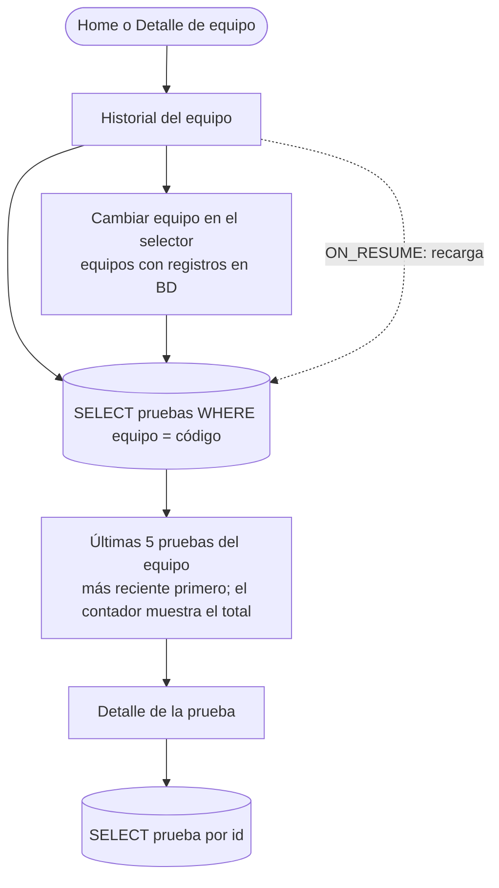
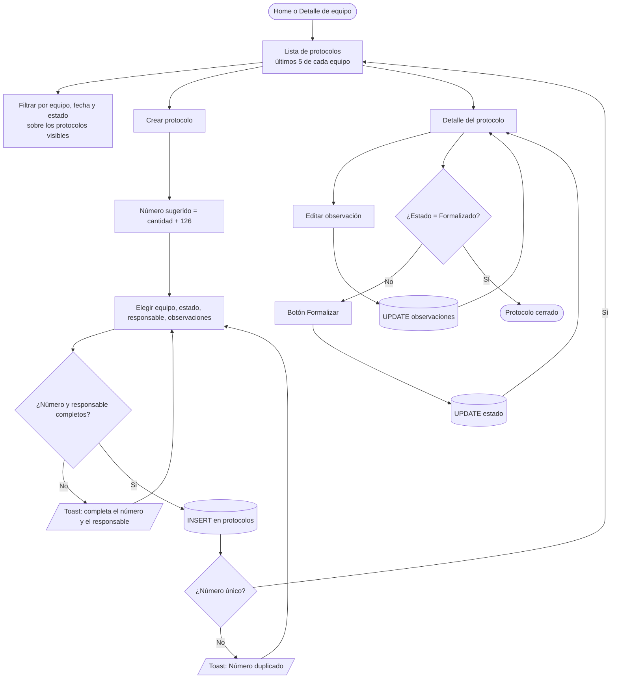
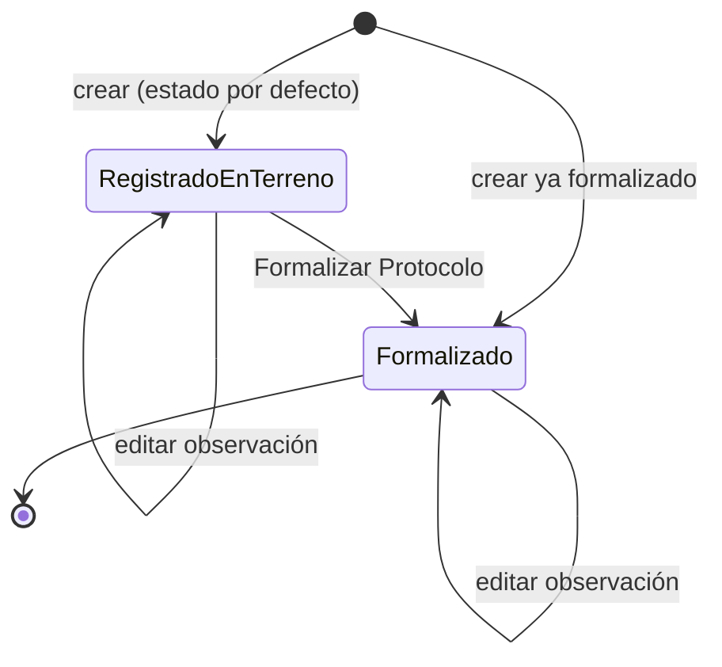

# Mapa de proceso de Electra

> Generado el 23/10/2026 a partir del código actual. Complementa a [ARCHITECTURE.md](ARCHITECTURE.md).
> Los nodos punteados indican pasos que existen en el código pero **no son alcanzables** hoy.

## 1. Proceso general (macro)



| Proceso | Actor | Entrada | Salida | Almacenamiento |
|---|---|---|---|---|
| Autenticación | Técnico | usuario + contraseña | acceso al Home | `SharedPreferences electra_usuarios` |
| Consulta de equipos | Técnico | código / tipo | ficha del equipo | lista fija en código |
| Registro de pruebas | Técnico | equipo, tipo, medición, resultado | fila en `pruebas` | SQLite `electra.db` |
| Historial | Técnico | código de equipo | lista de pruebas → detalle | SQLite |
| Gestión de protocolos | Técnico / responsable | equipo, responsable, estado | fila en `protocolos`, formalización | SQLite |

## 2. Autenticación y registro de usuario



> La sesión **no se persiste**: en cada arranque el proceso comienza en Login.

## 3. Consulta de equipos



## 4. Registro de una prueba eléctrica



## 5. Historial y detalle de pruebas



## 6. Gestión de protocolos



### Ciclo de vida de un protocolo



## 7. Cobertura de pruebas por proceso

Estado de la ejecución del 23/10/2026 en el emulador Pixel 9a, después de introducir
ViewModels y repositorios: **33 tests unitarios + 45 instrumentados, todos aprobados**.

| Proceso / paso | Test | Tipo |
|---|---|---|
| Rutas y argumentos de navegación | `navigation/RoutesTest` (5) | Unitario JVM |
| Login y Registro: lógica y todas las reglas de validación | `ui/viewmodel/AutenticacionViewModelTest` (7) | Unitario JVM |
| Registrar prueba, historial y detalle de pruebas | `ui/viewmodel/PruebasViewModelTest` (9) | Unitario JVM |
| Lista, creación y detalle de protocolos (número sugerido, duplicado, formalizar, observaciones) | `ui/viewmodel/ProtocolosViewModelTest` (11) | Unitario JVM |
| Registro: validaciones y alta en pantalla | `ui/screen/PantallasUiTest` `registro_*` (6) | UI Compose |
| Login: credenciales inválidas / válidas | `PantallasUiTest` `login_*` (2) | UI Compose |
| Home y Consulta de equipos | `PantallasUiTest` `home_*`, `equipos_*` (6) | UI Compose |
| Registrar prueba en pantalla (sin medición / guardado) | `PantallasUiTest` `registrarPrueba_*` (2) | UI Compose |
| Historial en pantalla | `PantallasUiTest.historial_*` (1) | UI Compose |
| Protocolos en pantalla: lista, formalizar, inexistente | `PantallasUiTest` `protocolos_*`, `detalleProtocolo_*` (3) | UI Compose |
| Almacenamiento de usuarios (hash, duplicados, mayúsculas, espacios) | `data/UsuariosLocalTest` (7) | Instrumentado |
| Pruebas y protocolos en SQLite + migración v1 → v2 | `data/PruebaDbHelperTest` (14) | Instrumentado SQLite |
| Registro → login → equipos → detalle | `navigation/FlujoPrincipalTest` | E2E (SQLite real aislado) |
| Login → registrar prueba → verla en el historial | `FlujoPrincipalTest` | E2E |
| Login → crear protocolo → verlo en la lista | `FlujoPrincipalTest` | E2E |

Los tests de UI usan los repositorios en memoria (`data/RepositoriosEnMemoria.kt`) inyectados en
el ViewModel. Los E2E usan `AppContainer(ContextoAislado)`, que trabaja con la base y las
preferencias reales del sistema, pero con prefijo `test_`.

### Cómo ejecutar

```powershell
# Unitarios
.\gradlew testDebugUnitTest

# Instrumentados sin desinstalar la app (conserva los datos del emulador)
.\gradlew installDebug installDebugAndroidTest
adb shell am instrument -w com.example.electra.test/androidx.test.runner.AndroidJUnitRunner
```

`connectedDebugAndroidTest` también funciona, pero desinstala la app al terminar y borra sus datos.
Los tests instrumentados usan `ContextoAislado` (`androidTest/.../TestContexto.kt`), que guarda la
base y las preferencias con prefijo `test_` y así no tocan los datos reales.
