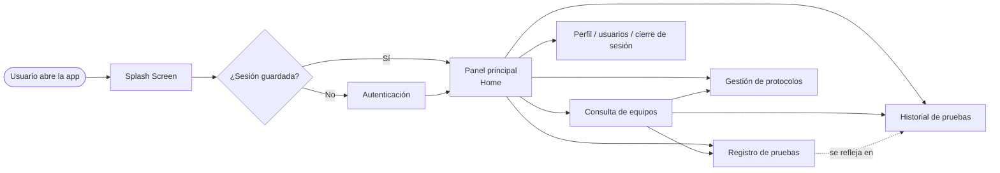
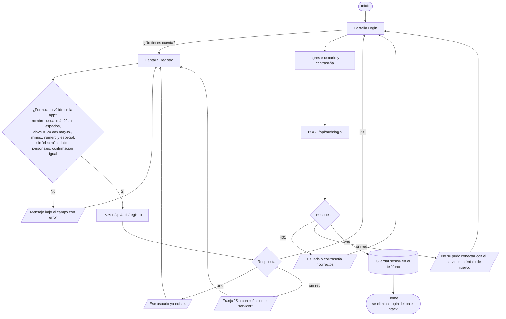
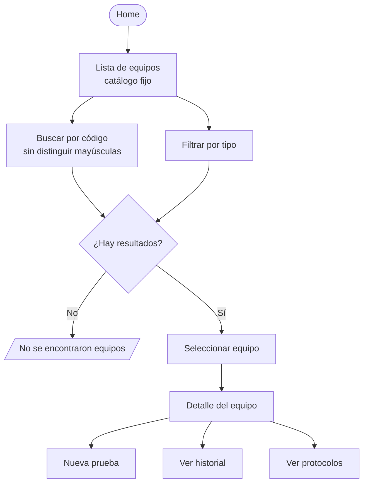
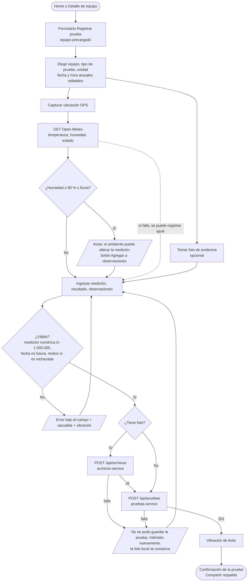
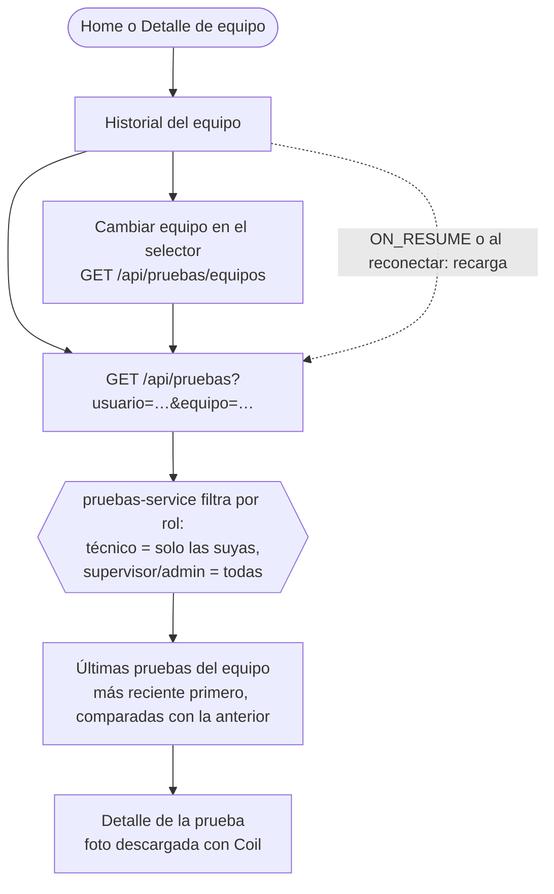
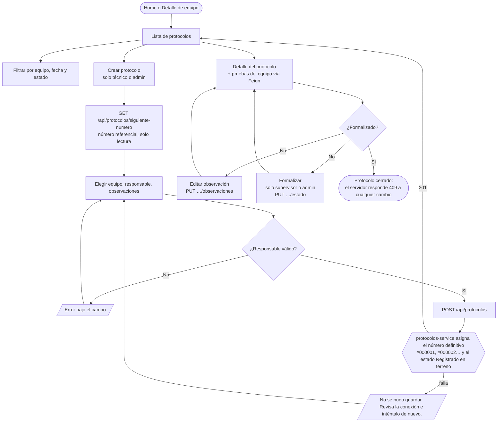
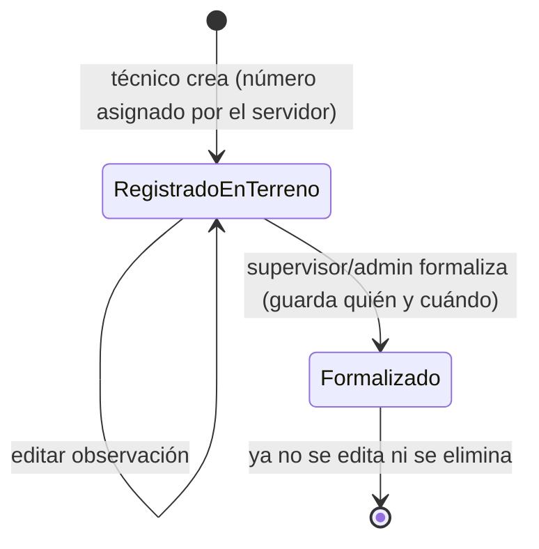
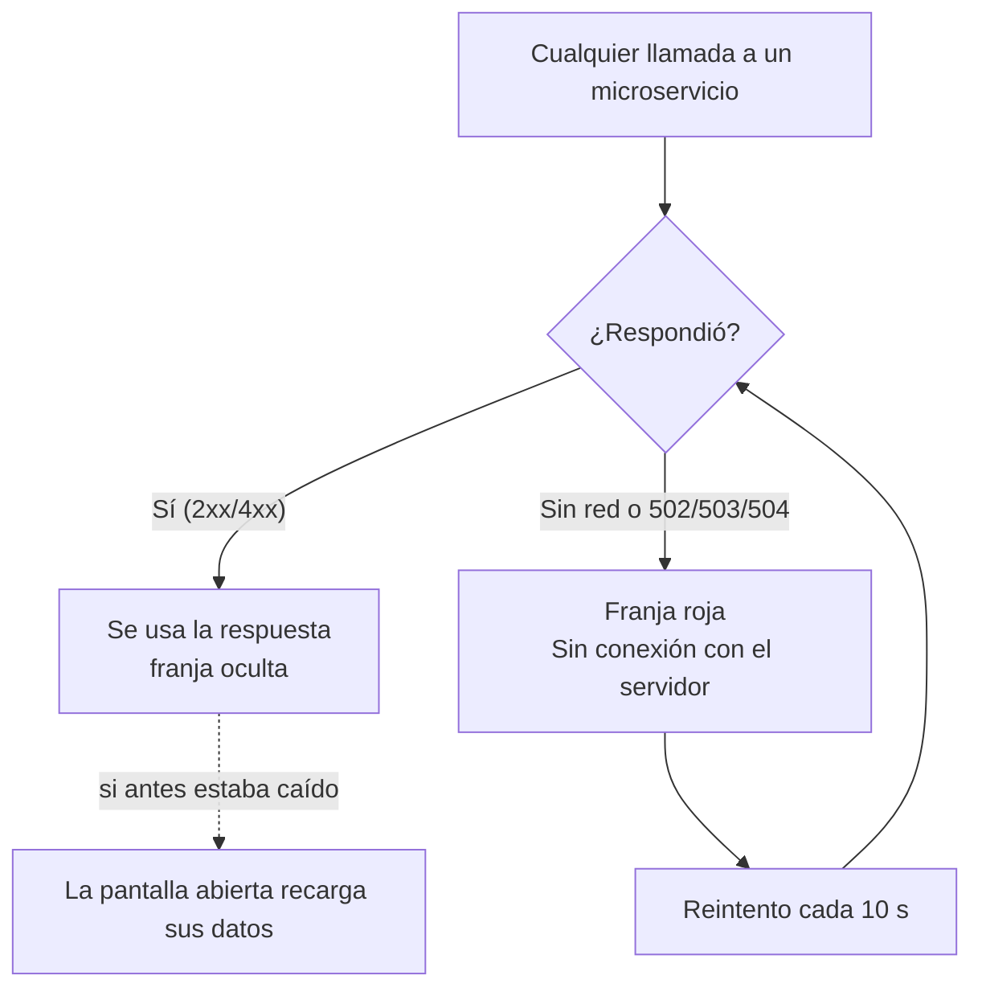

# Mapa de proceso de Electra

> Actualizado el 21/11/2026 (Evaluación Final). Complementa a [ARCHITECTURE.md](ARCHITECTURE.md).
> Todos los datos se guardan en los microservicios del backend
> ([Electra-Backend](https://github.com/Simon2853/Electra-Backend)); la app los consume con Retrofit
> a través del API Gateway.

## 1. Proceso general (macro)



| Proceso | Actor | Entrada | Salida | Dónde se guarda |
|---|---|---|---|---|
| Autenticación | Todos | usuario + contraseña | sesión abierta | usuarios-service (`electra_usuarios`, clave BCrypt); sesión en `SharedPreferences` |
| Consulta de equipos | Todos | código / tipo | ficha del equipo | catálogo fijo en la app |
| Registro de pruebas | Técnico / Admin | equipo, tipo, medición, resultado, foto, GPS, clima | prueba registrada | pruebas-service (`electra_pruebas`) + foto en archivos-service |
| Historial | Todos (según rol) | código de equipo | lista de pruebas → detalle | pruebas-service |
| Gestión de protocolos | Técnico crea · Supervisor formaliza | equipo, responsable, observaciones | protocolo numerado, formalización | protocolos-service (`electra_protocolos`) |
| Gestión de usuarios | Admin | usuario + rol nuevo | rol actualizado | usuarios-service |

## 2. Autenticación y registro de usuario



> La sesión **se mantiene** al cerrar la app: al abrirla de nuevo se entra directo al Home hasta que
> el usuario use _Perfil → Cerrar sesión_.

## 3. Consulta de equipos



## 4. Registro de una prueba eléctrica



## 5. Historial y detalle de pruebas



## 6. Gestión de protocolos



### Ciclo de vida de un protocolo



## 7. Conexión con el servidor



## 8. Cobertura de pruebas por proceso

Ejecución del 21/11/2026: **78 pruebas unitarias, todas aprobadas**, con **91 % de cobertura de
líneas** del código lógico (JaCoCo). Se ejecutan en la JVM con APIs falsas que responden como los microservicios.

| Proceso / paso | Archivo de pruebas |
|---|---|
| Login, registro, recuperar contraseña, reglas de validación, 401/409 y sin red | `AutenticacionTest` (17) |
| Perfil, editar nombre y foto (subida al servidor), cambiar contraseña, roles, gestión de usuarios, tema | `PerfilTest` (17) |
| Registrar prueba (validaciones, foto, GPS, clima Open-Meteo), historial, comparación, detalle, Home | `PruebasElectricasTest` (22) |
| Crear, listar, formalizar y editar protocolos, permisos, número del servidor, 409 en formalizados, reconexión automática | `ProtocolosTest` (22) |

### Cómo ejecutar

```powershell
.\gradlew testDebugUnitTest              # pruebas unitarias
.\gradlew coberturaPruebas               # + informe en app/build/reports/cobertura/html/index.html
.\gradlew verificarCoberturaPruebas      # falla si la cobertura baja del 80 %
```
