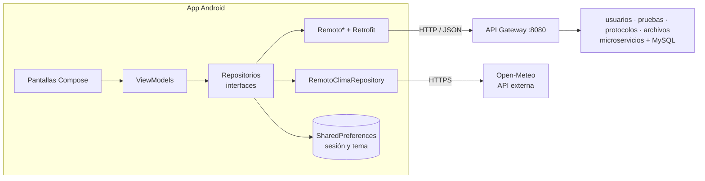
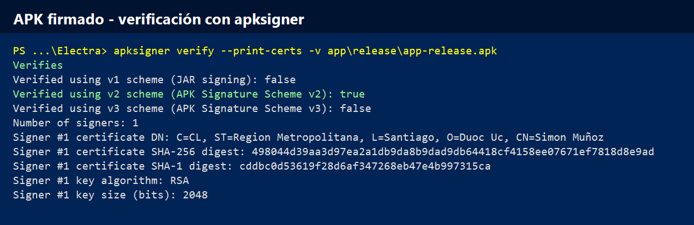
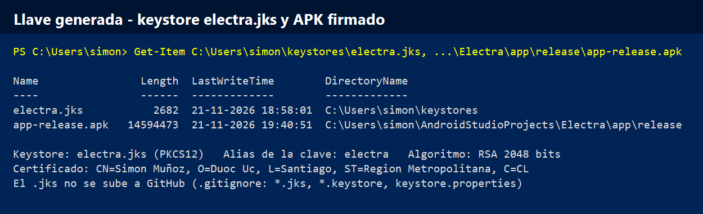

# Electra — Registro de pruebas eléctricas en terreno

Aplicación Android para **Induztek Ingeniería SpA** (caso CITT Plaza Norte, DSY1105 Desarrollo de
Aplicaciones Móviles). Permite que el ingeniero o técnico registre en el mismo momento cada prueba
eléctrica que hace en terreno (transformadores, relés, celdas, cables), con evidencia de foto y GPS,
consulte el historial comparable de cada equipo y formalice los protocolos. Además, puede entregar
de inmediato un respaldo al cliente sin volver a un computador.

Los datos viven en un **backend de microservicios** (Spring Boot + MySQL) al que la app se conecta
con **Retrofit** a través de un **API Gateway**:
👉 [Electra-Backend](https://github.com/Simon2853/Electra-Backend) (repositorio aparte, con su propia guía para levantarlo).

> Todos los datos son ficticios. No se usan protocolos reales de clientes.

## Integrantes

| Nombre | Rol en el proyecto |
|---|---|
| **Simón Muñoz** | Proyecto individual: diseño, desarrollo de la app Android y de los microservicios, pruebas y documentación. |

## Problema que resuelve

Hoy el cliente no recibe ningún respaldo en el momento de la prueba: el técnico anota en papel y
transcribe días después. Electra:

- **Registra la prueba en terreno** con formulario validado, foto del equipo, ubicación GPS y el clima
  del lugar, y la deja en estado _registrada en terreno_.
- **Entrega un respaldo inmediato** al cliente (botón _Compartir respaldo_: correo, WhatsApp, etc.).
- **Guarda un historial trazable por equipo** en el servidor y compara cada medición con la anterior del mismo tipo.
- **Formaliza protocolos** (_Registrado en terreno → Formalizado_) desde el teléfono; solo el supervisor
  o el administrador pueden hacerlo y, una vez formalizado, ya no se modifica.
- **Comparte los datos entre usuarios y dispositivos**: lo que registra el técnico lo revisa el supervisor desde su propio teléfono.

## Funcionalidades implementadas

| Requisito de la evaluación | Implementación |
|---|---|
| Consumo de microservicios con Retrofit | `data/remote/`: una interfaz Retrofit por microservicio (`Apis.kt`), DTOs (`Dtos.kt`) y repositorios `Remoto*` que reemplazan a los locales sin cambiar ViewModels ni pantallas. Todas las llamadas van al **API Gateway** (puerto 8080); la URL se configura en un solo lugar (`ConfiguracionApi.BASE_URL`). |
| Manejo de errores de red | `Conexion.llamar` captura los fallos de red y los 502/503/504 del Gateway: la app no se cae y muestra la franja _"Sin conexión con el servidor"_. Mientras dure, reintenta cada 10 s y, al volver el servidor, la pantalla abierta recarga sus datos sola. |
| Fotos en el servidor | La foto de evidencia y la de perfil se suben a `archivos-service` (multipart) y se muestran con **Coil** usando el mismo cliente HTTP que Retrofit. |
| API externa | **Open-Meteo** (`data/remote/OpenMeteo.kt`, sin clave): al capturar el GPS en _Registrar prueba_ se muestran temperatura, humedad y estado del tiempo; con humedad ≥ 80 % o lluvia se advierte que el ambiente puede alterar la medición, y el técnico puede agregarlo a las observaciones. Va directo a Internet, no pasa por el Gateway. |
| Splash Screen | `core-splashscreen` con el logo de Electra (`Theme.Electra.Splash`), en modo claro y oscuro. |
| Pruebas unitarias | **78 pruebas** JUnit en 4 archivos de `app/src/test` (por funcionalidad), con servidor falso; **91 % de cobertura** de líneas del código lógico medida con JaCoCo (mínimo exigido 80 %). |
| Interfaz organizada y navegación clara | Material 3 con paleta corporativa centralizada (`ui/theme`), barra superior común, Home con resumen real, 16 pantallas conectadas en un `NavHost`, tema claro / oscuro / del sistema. |
| Formularios validados con íconos y mensajes | Login, Registro, Recuperar contraseña, Editar perfil, Cambiar contraseña, Registrar prueba, Crear protocolo y Editar observación. Cada campo muestra ícono de error rojo + mensaje animado o check verde si es válido. Las reglas se validan en la app (`validation/Validaciones.kt`) **y de nuevo en el servidor**. |
| Roles y permisos | Técnico, Supervisor y Administrador (`model/Rol.kt`). El servidor aplica la misma regla: el técnico solo ve lo suyo, el supervisor ve todo y formaliza, el administrador además gestiona usuarios. |
| Animaciones | Transiciones entre pantallas, sacudida del formulario al fallar, mensajes de error que se despliegan, botón con progreso, barra de fortaleza de contraseña, contadores del Home, franja de conexión que aparece y desaparece. |
| Recursos nativos (≥ 2) | **Cámara** (`TakePicture` + `FileProvider`), **GPS** (`LocationManager`, con tiempo máximo y respaldo con la última ubicación), **vibración** y **hoja de compartir** del sistema. |

## Endpoints utilizados

### Microservicios propios (a través del API Gateway)

Todas las rutas se llaman sobre `BASE_URL` (hoy `https://zn6r5l5v-8080.brs.devtunnels.ms/`, el Gateway
expuesto con el reenvío de puertos de VS Code). El Gateway las reenvía al microservicio según el prefijo.
Están declaradas en `app/src/main/java/com/example/electra/data/remote/Apis.kt`; la documentación
Swagger de cada servicio está en `http://localhost:808X/swagger-ui.html`.

| Método | Ruta | Microservicio | Uso en la app |
|---|---|---|---|
| POST | `/api/auth/registro` | usuarios-service | Registro de cuenta (201 creada · 409 usuario repetido) |
| POST | `/api/auth/login` | usuarios-service | Iniciar sesión (200 · 401 contraseña incorrecta) |
| POST | `/api/auth/restablecer` | usuarios-service | Recuperar contraseña (204) |
| GET | `/api/usuarios` | usuarios-service | Gestión de usuarios (solo administrador) |
| GET | `/api/usuarios/{usuario}` | usuarios-service | Nombre, rol y avatar en Home y Perfil |
| PUT | `/api/usuarios/{usuario}/nombre` | usuarios-service | Editar perfil |
| PUT | `/api/usuarios/{usuario}/contrasena` | usuarios-service | Cambiar contraseña (204 · 401 clave actual incorrecta) |
| PUT | `/api/usuarios/{usuario}/avatar` | usuarios-service | Foto o color del avatar |
| PUT | `/api/usuarios/{usuario}/rol` | usuarios-service | Cambiar el rol de otro usuario (administrador) |
| POST | `/api/pruebas` | pruebas-service | Registrar prueba eléctrica |
| GET | `/api/pruebas?usuario=…&equipo=…` | pruebas-service | Home, historial del equipo, detalle de protocolo (filtra según el rol) |
| GET | `/api/pruebas/equipos?usuario=…` | pruebas-service | Selector de equipos con registros |
| GET | `/api/pruebas/{id}?usuario=…` | pruebas-service | Detalle y confirmación de la prueba |
| POST | `/api/protocolos` | protocolos-service | Crear protocolo (el servidor asigna el número) |
| GET | `/api/protocolos?usuario=…` | protocolos-service | Lista de protocolos y resumen del Home |
| GET | `/api/protocolos/siguiente-numero` | protocolos-service | Número referencial al crear; también se usa para el reintento de conexión |
| GET | `/api/protocolos/{numero}?usuario=…` | protocolos-service | Detalle del protocolo |
| PUT | `/api/protocolos/{numero}/estado` | protocolos-service | Formalizar (supervisor o admin · 409 si ya está formalizado) |
| PUT | `/api/protocolos/{numero}/observaciones` | protocolos-service | Editar observaciones (409 si está formalizado) |
| POST | `/api/archivos?categoria=…&subidoPor=…` | archivos-service | Subir foto de evidencia o de perfil (multipart, campo `archivo`) |
| GET | `/api/archivos/{id}` | archivos-service | Mostrar la foto con Coil |
| DELETE | `/api/archivos/{id}?usuario=…` | archivos-service | Borrar la foto de perfil anterior |

Ejemplo de respuesta (`POST /api/auth/login`):

```json
{ "id": 7, "usuario": "tec@demo.cl", "nombre": "Tecnico Demo", "rol": "tecnico",
  "veRegistrosDeTodos": false, "avatar": { "color": null, "fondo": null, "foto": null }, "creadaEn": 1795278160925 }
```

### API externa: Open-Meteo

Gratuita y sin clave. Se llama directo a Internet con su propio Retrofit (`data/remote/OpenMeteo.kt`),
sin pasar por el Gateway, cuando el técnico captura el GPS en _Registrar prueba_.

| Método | URL | Uso en la app |
|---|---|---|
| GET | `https://api.open-meteo.com/v1/forecast?latitude={lat}&longitude={lon}&current=temperature_2m,relative_humidity_2m,weather_code` | Clima actual en el lugar de la prueba |

Ejemplo de respuesta (solo la parte que usa la app):

```json
{ "current": { "temperature_2m": 18.4, "relative_humidity_2m": 62, "weather_code": 2 } }
```

La app lo muestra como _"18,4 °C · 62 % humedad · Parcialmente nublado"_ y advierte si la humedad es
≥ 80 % o hay precipitación (`model/Clima.kt`).

## Arquitectura



```
com.example.electra
├── data/          Interfaces de repositorio, AppContainer, sesión/tema y repositorios en memoria (pruebas)
│   └── remote/    Retrofit: configuración, APIs, DTOs, Conexion, repositorios remotos y Open-Meteo
├── device/        Recursos nativos: cámara (archivos), GPS, vibración, compartir
├── model/         Prueba, Protocolo, Rol, Clima, catálogo de equipos y textos de respaldo
├── navigation/    Rutas y NavHost con transiciones
├── validation/    Reglas de validación puras (sin Android)
└── ui/
    ├── components/  Campo validado, selector, botón con carga, barra superior, aviso sin conexión
    ├── screen/      Pantallas Compose
    ├── theme/       Paleta y tema Material 3
    └── viewmodel/   ViewModels con StateFlow para cada pantalla con estado o datos
```

Más detalle en [ARCHITECTURE.md](ARCHITECTURE.md) y [PROCESO.md](PROCESO.md).

## Requisitos

- Android Studio en una versión compatible con AGP 9.4 (usa su JDK incluido).
- Android SDK 37; dispositivo o emulador con Android 7.0 (API 24) o superior.
- El **backend levantado** (ver el README de [Electra-Backend](https://github.com/Simon2853/Electra-Backend):
  `iniciar-todo.cmd` o paso a paso) y MySQL encendido en Laragon.
- Para probar la cámara y el GPS en el emulador: _Extended controls → Camera / Location_.
- Para el clima: el emulador o teléfono necesita acceso a Internet.

## Cómo ejecutar

1. Levantar el backend y comprobar que en http://localhost:8761 aparezcan los 5 servicios en estado UP.
2. Ajustar `BASE_URL` en `app/src/main/java/com/example/electra/data/remote/ConfiguracionApi.kt`.
   Hoy apunta a la URL pública del túnel de VS Code (`https://zn6r5l5v-8080.brs.devtunnels.ms/`), que solo
   responde mientras ese túnel y el backend del autor estén encendidos. Para probarlo en otro computador hay que cambiarla:
   - **Emulador** (backend en el mismo computador): `http://10.0.2.2:8080/`.
   - **Teléfono físico**: la URL pública del reenvío del puerto 8080 en VS Code (pestaña _Puertos_,
     visibilidad _Public_), por ejemplo `https://abc123-8080.brs.devtunnels.ms/`. Debe terminar en `/`
     y cambia cada vez que se crea el túnel.
3. Abrir el proyecto en Android Studio, esperar la sincronización de Gradle, elegir el dispositivo y presionar **Run ▶**.
4. En Android 17 la app pide el permiso de **dispositivos cercanos / red local**: hay que aceptarlo
   para llegar a `10.0.2.2` (con la URL pública no se pide).
5. En la app: **Regístrate**, crea tu cuenta, inicia sesión y usa **Registrar nueva prueba**.

La sesión queda guardada en el teléfono: al volver a abrir la app se entra directo al Home hasta que se
use **Perfil → Cerrar sesión**.

Desde la terminal:

```powershell
.\gradlew assembleDebug          # genera app/build/outputs/apk/debug/app-debug.apk
.\gradlew installDebug           # instala en el dispositivo conectado
```

## Pruebas y cobertura

Las pruebas evaluadas son **unitarias** (JVM, sin emulador) y están en `app/src/test/java/com/example/electra/`:

| Archivo | Pruebas | Qué cubre |
|---|---:|---|
| `AutenticacionTest.kt` | 17 | Login, registro, recuperar contraseña, reglas de validación, errores del servidor y sin conexión |
| `PerfilTest.kt` | 17 | Perfil, editar nombre y foto de perfil (subida al servidor), cambiar contraseña, roles, gestión de usuarios y tema |
| `PruebasElectricasTest.kt` | 22 | Registrar prueba (validaciones, foto, GPS, clima de Open-Meteo), historial, detalle y Home |
| `ProtocolosTest.kt` | 22 | Crear, listar, formalizar y editar protocolos, permisos por rol, número del servidor, reconexión automática |
| `Apoyo.kt` | — | Datos de ejemplo y **APIs falsas** que responden como los microservicios (códigos 200, 201, 401, 404, 409, 503 o falta de red) |

```powershell
.\gradlew testDebugUnitTest              # ejecuta las 78 pruebas
.\gradlew coberturaPruebas               # + informe JaCoCo en app/build/reports/cobertura/html/index.html
.\gradlew verificarCoberturaPruebas      # falla si la cobertura baja del 80 %
```

La cobertura (91 % de líneas) se mide sobre el código lógico: `model`, `validation`, `ui/viewmodel` y
`data` (incluidos los repositorios remotos). Se excluye lo que necesita Android en ejecución: pantallas,
navegación, tema, recursos del dispositivo, `AppContainer` y `SharedPreferences`.

> Como pide la pauta, no hay pruebas de interfaz ni instrumentadas (`androidTest`): todas son unitarias.

## APK firmado

El APK de entrega se firma con un keystore propio (`.jks`) desde Android Studio:

1. **Build → Generate Signed App Bundle or APK… → APK → Next**.
2. **Key store path → Create new…**: guardar el archivo fuera del proyecto (p. ej. `C:\Users\<usuario>\keystores\electra.jks`),
   con contraseña del keystore, alias `electra` y contraseña de la clave; completar al menos el nombre en _Certificate_.
3. **Next → variante `release` → Create**.
4. El APK queda en `app/release/app-release.apk`.

**Configuración técnica en `app/build.gradle.kts`:** el bloque `signingConfigs { release }` firma la
variante release con los datos de `keystore.properties` (ruta del `.jks`, alias y contraseñas). Para usarlo:

1. Copiar [`keystore.properties.example`](keystore.properties.example) como `keystore.properties` y completar las contraseñas.
2. Ejecutar `.\gradlew assembleRelease` → `app/build/outputs/apk/release/app-release.apk` firmado.

Si `keystore.properties` no existe, el proyecto compila igual y se firma con la ventana de Android Studio.

> El `.jks` y sus contraseñas **no se suben a GitHub** (`.gitignore` excluye `*.jks`, `*.keystore` y
> `keystore.properties`). Si se pierden, no se puede publicar una actualización firmada con la misma clave.

El APK usa la `BASE_URL` que tenga el código al compilarlo (hoy el Gateway público), así que funciona en
cualquier teléfono con Internet mientras el backend y el túnel de VS Code estén encendidos.

### Capturas

**APK Firmado** (verificación de la firma con `apksigner`):



**Llave generada** (keystore `electra.jks` con el alias `electra`):


